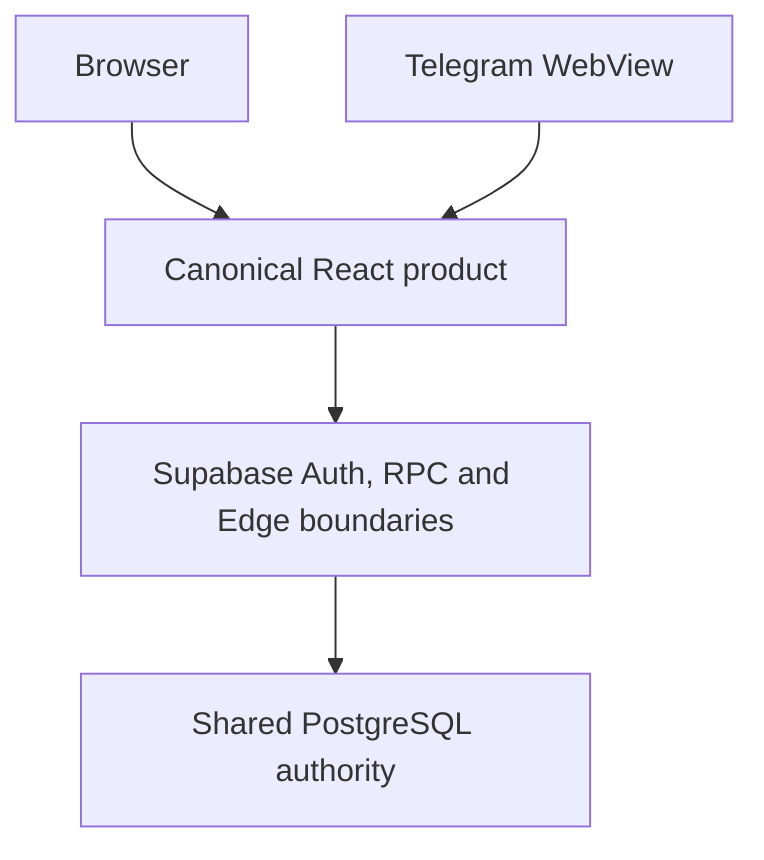

# KRISTOU SCHOOL — STRUCTURE AND ARCHITECTURE

Status: **PRIMARY ARCHITECTURE CONTRACT**

Revision: **2026-11-14 — DOC-D2**

Repository: `funmarket/KRISTOUSCHOOL`

Product boundary: **one school, one shared Browser/Telegram product, one backend/data authority**

This document defines runtime boundaries, domain ownership and integration rules. Accepted behavior belongs in [requirements.md](requirements.md); canonical relationships and write invariants belong in [docs/CANONICAL_MODEL.md](docs/CANONICAL_MODEL.md); durable decisions belong in [docs/DECISIONS.md](docs/DECISIONS.md); execution discipline belongs in [docs/LIVING_BUILD_PLAN.md](docs/LIVING_BUILD_PLAN.md); dated evidence belongs in [progress.md](progress.md).

This revision follows the Owner-approved **KRISTOU SCHOOL Master Execution Plan, revision 3**, saved as `KRISTOU_MASTER_EXECUTION_PLAN(1).txt`, SHA-256 `d0213cd47d3cbf94d749a7234a9ab29cc965448c0c39850f9d234978b053e3cd`, and accepted requirements revision DOC-D1. It reconciles **structure.md only**. Other authorities await their own document tasks; older Attendance/grades exclusions, historical runtime claims and alternative queues do not override these newer decisions. No application, SQL, account, infrastructure, commit, push, merge or deployment is authorized here. Backend implementation remains paused.

## 1. Current topology and target

### 1.1 Dated source and inventory checkpoint

The observations below were inspected on 2026-11-14. They establish the starting point, not production readiness. Refresh them before implementation or release.

| Surface | Observed state | Boundary of the evidence |
| --- | --- | --- |
| Repository | `main@32067aa961620facffe4ff906c5598f68d27d6ff`; PR #15 open/draft/unmerged at `473d889c1b8e86bf71f88f66b67779f4c3502f8e` | The PR candidate is separate from main and the unknown exact live frontend SHA |
| Local documentation candidate | `fix/gov01-source-database-parity@2dc828a66968246c76f325edfd603a4771c83555`; existing accepted local `requirements.md` edit | Local HEAD has the PR-equivalent source tree; DOC-D1/D2 edits are uncommitted, not GitHub publication |
| Frontend | One Vite/React/TypeScript app; tab/subtab composition, seven role homes plus public home, status screen and Owner oversight | Navigation guards are presentation, not backend authorization |
| Identity/governance | Supabase Auth integration, server username resolver, explicit Telegram linking/re-entry and typed governance adapters exist | Do not describe all roles/login as mocks; presence does not prove every privileged operation |
| Existing backend | Supabase project `KRISTOUSCHOOL / ofppapwofhovhroyjtkc`; six public tables with RLS enabled; seven migration records; `claim_telegram_account_link` exists | RLS flags and object counts are inventory, not allow/deny or concurrency acceptance |
| Current public tables | `profiles`, `role_assignments`, `telegram_identities`, `account_link_challenges`, `manager_capability_grants`, `account_governance_audit_logs` | Table names do not imply full feature or Manager delegation completion |
| Migration source | Six SQL files on main; seven in the PR-equivalent checkout, including recovered canonical roles | Historical source/live version mappings remain deliberate; no blind history repair or replay |
| School-domain views | Context still imports mock school content; many actions are local, placeholders or unavailable; Pickup commands are explicitly backend-blocked | No installed People/Academics/Family/Enrollment/Attendance/Assessment/calendar/Pickup tables were found among the six public tables |
| Storage and Realtime | **0 Storage buckets**; **0 public tables in the supabase_realtime publication** | No working private uploads or published table-change stream is assumed; this says nothing about all Broadcast/Presence channels |
| Client database types | `src/lib/supabase.ts` contains handwritten `DatabaseSchema`, including absent `users`, `children`, `parent_notes` and `pickup_records` tables and an empty Functions map; profile Row omits `account_status` | These declarations are not a generated or installed-schema authority. Governance uses a separate RPC interface/cast; contract refresh is required, not claimed complete |
| Owner manual acceptance | Owner reports successful deployed login, workspace navigation and non-impersonating oversight with Return to My Home | Valid manual evidence; not direct RLS/concurrency proof or exact-candidate release acceptance |
| Frontend hosting | Vercel is the current frontend host; exact deployed SHA remains unestablished by this review | The old missing-public-config diagnosis is historical; do not report it as a current failure |

Detailed migration/function provenance remains in the master and dated [docs/REMOTE_SCHEMA_INVENTORY.md](docs/REMOTE_SCHEMA_INVENTORY.md). The master records username handler v6 versus newer source and protected Telegram handler parity limits; versions require fresh release inspection, not assumptions from this architecture file. Never redeploy old Telegram source merely to make source and hosting look alike.

### 1.2 Target and protected topology

Continue the **existing** React product and Supabase project. Browser and Telegram WebView share one feature implementation, navigation authority, API contract and canonical durable state. Telegram adapts host mechanics and verified identity transport; it is not another frontend, role system, router or business backend.

Supabase Auth owns Web credentials and provider sessions. The current canonical account maps `auth.users.id` to `profiles.id`; role assignments are separate records and may be plural. Do not describe every role assignment as a one-to-one Auth mapping or silently introduce a second User table. School person/student identity may exist independently of login credentials; any account association is explicit and verified.

Use the smallest existing topology that meets the accepted scope. No monorepo conversion, Node API runtime, worker fleet, second frontend, speculative packages, school registry, inter-school memberships or school switching. A measured need and explicit architecture decision must precede any additional runtime.

The following diagram describes source-level connectivity of existing identity/governance paths, not completion of future school features:

## 2. Runtime and source boundaries

### 2.1 Existing source map

These paths exist in the inspected checkout. They identify current reading/edit owners, not permission to change them in DOC-D2.

| Existing path | Current responsibility | Target discipline |
| --- | --- | --- |
| `src/main.tsx`, `src/App.tsx` | Entry and tab/subtab composition | Preserve one product; integrate actual permitted destinations without a new parallel router |
| `src/context/AppContext.tsx` | Shared session/host/presentation composition plus remaining mock school data/actions | Migrate each accepted domain slice through its typed boundary; do not make this a permanent global business database |
| `src/types.ts` | UI/product types | Separate view models from generated DB contracts; a UI interface does not create a table or permission |
| `src/lib/supabase.ts` | Public client configuration, handwritten DB typing | Keep one client composition owner; refresh schema types under the contract gate |
| `src/lib/auth.ts`, `src/lib/username.ts`, `src/lib/telegram.ts` | Shared credentials/profile loading, identifier rules, Telegram invocation/deep link | Preserve accepted auth and host behavior; no feature-owned credentials or browser contact lookup |
| `src/lib/accountGovernance.ts` | Governance RPC adapters, command/result types and an in-memory test harness | Reuse existing RPCs; test harness is not a server or database concurrency proof |
| `src/components/AuthModal.tsx`, `src/components/Navbar.tsx` | Shared authentication UI and navigation | Preserve AR/FR/EN copy, existing geometry and current login policy |
| `src/components/homepages/HomePageResolver.tsx`, `src/components/homepages/homepageAccess.ts` | Role-home presentation and non-impersonating oversight | Actor stays unchanged; every private operation still needs server authorization |
| `src/components/homepages/OwnerGovernanceWorkspace.tsx` | Existing governance screens | Domain adapters own effects; no UI-created privilege |
| `src/components/views/ClassesManagementView.tsx`, `src/components/views/ClassCommunityView.tsx` | Roster and community surfaces | Wire real Academics/People/Family/content contracts; keep global member calendar accessible without a class |
| `src/components/views/ParentNotesView.tsx`, `src/components/views/PickupBoardView.tsx` | Notes and safety-locked Pickup UI | Notes quota belongs server-side; no Pickup unlock without accepted backend |
| `src/components/views/RegistrationView.tsx`, `src/components/views/FoodMenuView.tsx`, `src/components/views/DirectoryView.tsx`, `src/components/views/HomeView.tsx` | Admission, food, directories and public content | Replace mock/local paths only in the owning accepted vertical slice |
| `src/i18n/translations.ts`, `src/i18n/authMessages.ts`, `src/i18n/homepages.ts`, `src/i18n/content.ts` | Shared interface/content localization | Arabic text within stable LTR shell; no mirrored control positions |
| `supabase/config.toml`, `supabase/migrations/`, `supabase/seed.sql` | Local stack, versioned schema/security, synthetic seed | Existing project remains; isolated replay before hosted changes |
| `supabase/functions/auth-username-signin/index.ts` | Username credential transport | New source is not automatically the installed handler |
| `supabase/functions/telegram-auth/index.ts`, `supabase/functions/telegram-link-challenge/index.ts`, `supabase/functions/_shared/telegram-init-data.ts` | Telegram link/re-entry handlers, challenge and verifier source | Preserve baseline; source/deployed drift is a scoped parity issue, not automatic deployment permission |
| `supabase/tests/`, `tests/` | SQL policy tests and Node tests | Distinguish real DB/API behavior, mocks, static guards and runtime evidence |
| `vite.config.ts`, `package.json`, `tsconfig.json` | Vite build/configuration and checking | Only public Supabase config enters browser; frontend typecheck excludes Edge Functions and cannot certify their runtime |

### 2.2 Frontend and server composition

React owns rendering, interaction, selection and presentation caches. It does not own account approval, capabilities, class membership, Attendance marks, grades, private object decisions or child release. Preserve current styles/logo, eight homes, Owner Teachers → Classes → Registration order, light-default/Pitch Black, mobile behavior and Arabic text inside a stable LTR shell.

Future feature adapters follow existing `src/lib` conventions unless a demonstrated boundary needs a small colocated feature module. Exact proposed filenames from the master remain packet candidates until inspected; do not pre-create folders or move the entire app. Do not put server authority in browser-imported `src/` modules. If application/domain modules are extracted for a Deno function, keep them in a server-only import graph compatible with the actual function deployment packaging; freeze exact paths in that packet. No new `src/server` hierarchy or dependency installation is commissioned by this document.

Edge Functions are narrow transport/composition boundaries: request parsing, verified actor, input validation, domain operation and typed response. Domain policy must not depend on React, HTTP or a Supabase client. Database adapters and function composition depend toward domain/application contracts; consumers do not import another domain’s concrete persistence implementation.

### 2.3 Schema, storage and environment boundaries

Versioned migrations own schema, constraints, indexes, grants, policies, SQL primitives and managed Storage-policy changes. PostgreSQL owns durable truth; object storage owns bytes. No dashboard-only schema owner, duplicate table family or automatic table creation from UI/mock types.

Use caller-scoped access and tested RLS when the identity transport supports it. A service-role credential stays server-side, bypasses RLS and therefore needs explicit caller/resource authorization with deny-case tests. Ordinary clients never receive it.

Storage is a managed service boundary, not an existing repository folder or currently provisioned bucket. Create only the minimal private bucket/descriptor/policy contract required by the first accepted consumer in MED-01. Local/staging/production URLs, keys, data and Auth settings remain isolated; local reset uses synthetic data and must never target hosted production.

## 3. Dependency and operation contracts

The common dependency direction is:

**Presentation → typed feature adapter → verified server identity/access → owning application/domain operation → transactional persistence and approved projections.**

Direct caller-scoped Supabase reads may use the same contract and RLS boundary without inventing an Edge Function for every query. Privileged or multi-row commands use the verified narrow RPC/function operation required by their invariant.

| Dependency rule | Required consequence |
| --- | --- |
| Identity supplies the canonical actor; Access Control supplies current account/role/grants | Requested roles, client role strings, stale claims and cached profiles never authorize an operation |
| Family/Academics/Enrollment supply relation, membership and eligibility facts | Attendance, Assessment, content and Pickup do not keep competing rosters or guardian lists |
| One domain consumes another through a narrow approved reader/operation | No cross-domain React orchestration of unreviewed SQL or multiple HTTP calls presented as one transaction |
| Source mutation, required audit and durable outbox commit atomically where required | Delivery failure cannot roll back or duplicate a committed business event |
| Expected version/idempotency and conflict behavior are explicit per command | Retries and genuine concurrent requests cannot silently overwrite another accepted change |
| Views, RPCs, files and realtime paths expose audience-filtered contracts | A base-table RLS flag or a signed URL’s existence is not full access proof |
| Read models/caches/aggregates are non-authoritative | Profile history, reports and Control Center totals reconcile with source records and carry freshness where relevant |

Calendar, Attendance, Assessment, admission, Parent Notes and Pickup each own their policy and transitions. Sharing a component or adapter transport does not transfer write authority. Structural extensibility means small coherent boundaries and tested contracts, not a generic management service.

## 4. Product-domain write ownership

The target boundaries below adopt the accepted master’s proposed Attendance/Assessment/calendar split for this architecture contract. They are **logical owners, not separate deployables or an installed schema**. DOC-D3 must reconcile conceptual relationships and invariants before new physical persistence. Unsettled fields/formulas/access policies remain the named decision gates.

| Durable concept | Canonical owner | Boundary |
| --- | --- | --- |
| Account, provider credentials/session, Telegram identity/challenge | Identity & Authentication | One canonical account; Supabase Auth credentials; explicit conflict-safe link/recovery; no person-name/contact merging |
| Account approval/status, effective roles and grants | Access Control | Owner-only privileged appointments; automatic approved Office bundle for ordinary operations; Manager explicit delegation; no Office self/privileged governance |
| Student/staff/parent identity and permitted contact/safety facts | People | School person can exist without credentials; account link explicit; restricted fields projected narrowly |
| Verified guardian-to-child relationship | Family | Sole parent scope; emergency contact or name match is not a guardian link |
| Year, level, class, subject, teacher/substitute assignment, student membership, teaching session, operational school date/closure | Academics | Sole academic scope/time context; temporary access bounded; past membership/session history retained |
| Admission application, requirements/documents and enrollment eligibility | Enrollment | Acceptance is not account approval, guardian link, collector authorization or class membership |
| Teacher registers/entries, corrections and absence-justification decision | Attendance | References pupil and approved teaching context; independent teachers; one counted entry per approved register identity; parent explanation is not mark authority |
| Assessments/marks, report calculation/publication and educational remarks | Assessment | School policy before formulas; published/draft audiences distinct; no editable Profile totals or general confidential case dossier |
| Class announcements/homework, class-content calendar, documents/gallery/questions | Class Community | Academics Class/membership is reused; no redundant ClassCommunity roster |
| Structured parent notes/replies and their quota/time/audience | Parent Notes | 11 parent-originated notes, 08:00 inclusive–18:00 exclusive Africa/Tunis, 08:00 reset; not generic Messages |
| Permitted short operational threads/messages | Messaging | Approved participants, 200-character limit; no student private DMs or Parent Notes loophole |
| School/global notices and publication audiences | Broadcasts | One publication; all-approved-school audience distinct from class targeting; links canonical calendar events |
| Dismissal policy, authorized collectors, arrival/release/early-leave records | Pickup | Sole physical-release authority; parent arrival and Attendance never release a child |
| Notification inbox/read/delivery state | Notifications | Source-event projection and safe deep link; no private-body duplication or source-state authority |
| Language, theme, sound/vibration preferences | Preferences | User-scoped presentation/delivery settings, not permissions |
| Weekly/day menu and publication | Food Menu | La Toque Gourmande; approved editors, governed media and deliberate public visibility |
| Public Teachers/Administration cards | School Directory | Approved presentation, separate from private People fields |
| Home/About/Contact/activities/clubs/inquiries/public gallery and other approved public content | Public Content | Explicit public publication; public calendar references approved source events rather than owning another operational calendar |
| Media descriptors and byte lifecycle | Media | Generic lifecycle only; owning product controls attachment meaning/audience |
| Safe sensitive-operation history | Audit | Source operation supplies safe metadata; no tokens/passwords/unnecessary private bodies |
| Durable asynchronous handoff | Async Foundation | Transactional outbox/delivery infrastructure; not another business owner or mandatory worker service |
| Own Profile and Student Profile | Projections/orchestration over Identity, People, Family, Academics, Attendance and Assessment | Each field has one owner and permitted editor; no denormalized mutable all-in-one profile ledger |
| School Settings | Owning domains, composed by authorized settings UI | No catch-all policy/configuration blob; changes do not retroactively rewrite history |
| Reports and Control Center | Authorized read projections of owning domains | Aggregates confer no mutation rights; unavailable source is not a misleading zero |
| Office/staff work queues and requests | School Operations application workflow over existing owners | Reuse admission/inquiry/other domain operations; DG-19 must identify owner/lifecycle of any genuinely new request before persistence |
| AI assistant | Optional authorized API client | No second database or autonomous sensitive administrative authority |

Transport/bus operations, tuition/payments, lunch ordering/payment, broad medical cases, automatic QR/face/geofence pickup, student private DMs and multi-school tenancy remain excluded. Existing service-card labels do not create those domains.

## 5. Security and privacy architecture

Every private operation verifies current actor, approved status, action capability and resource scope. Test pending/rejected/suspended/revoked status with old sessions, removed membership, revoked delegation and temporary-assignment expiry. Do not reopen protected Telegram lifecycle code as a shortcut; future feature transport must independently prove current server authorization.

Parents use verified Family links; Students use their own active membership; Teachers use assigned class/subject/session; Managers use delegated scope; School Staff use job-specific capability. Approved Office personnel receive the ordinary school-office bundle, not unrestricted medical, grade override or child-release authority. Only Owner appoints/governs Owner/Manager privileges; preserve a recoverable last Owner and reauthorize callers after lock waits.

Exposed tables require deliberate least-privilege grants and tested RLS. Views require appropriate invoker/access semantics; SQL functions require reviewed ownership, execution grants and fixed search paths where privileged. A service-role or RLS-bypassing test runner cannot establish ordinary row isolation. Test API, RPC, storage and realtime denial as well as DB policies.

Minimize private data in projections/logs/notifications/exports. Emergency contacts are not automatically guardians or collectors. Minimal safety fields require DG-13 audience/verification policy and are narrower than full medical/enrollment records. Media policies inherit the owning resource scope; short-lived signed delivery still needs reviewed issue/revocation/expiry behavior. Synthetic fixtures only outside production.

Use timezone-aware instants and **Africa/Tunis** for school business time. All-day dates use date-only semantics; a multi-day span covers every affected school date without device timezone shifts. No school-day absence is inferred from one lesson, and no calendar cancellation or pupil mark sets Pickup RELEASED.

## 6. Browser and Telegram identity boundary

Preserve username/email-plus-password public login, phone-without-email signup requiring a chosen username, internal phone-backed username resolution, Unicode handles and approval separation. Full name is display data; public phone login and username-only provisioning remain unsupported.

Browser uses the provider session to load the same canonical account. Telegram explicit linking validates signed fresh initData and atomically claims the one-time challenge; established later re-entry resolves that linked account without creating another account or issuing a Supabase Auth session. Preserve the agreed `09ffacf80daa4f546140053db441abb96c68ef8b` auth/link/challenge/cache/session baseline.

A restored Telegram profile is not a Supabase bearer token or direct RLS authority. Each future private operation must define a verified Telegram transport with the same current role/resource policy and deny cases. Do not use a client profile/user ID to invoke a privileged handler, silently mint sessions, implement a second auth system or redeploy protected handlers during documentation work.

Owner workspace inspection changes presentation, not actor. Banner and Return to My Home remain; private calls retain the actual Owner identity and policy. Manager oversight is explicitly delegated and cannot become Owner privilege.

## 7. Vertical wiring and feature dependencies

The master owns execution order; this table explains contracts between slices, not an alternative queue.

| Slice | Required providers | Consumer/side-effect boundary | Master references |
| --- | --- | --- | --- |
| Existing governance closeout | Identity/Access, current migration parity, real isolated RLS/concurrency runner | Reuse existing `governance_*` RPC interfaces and workspace; Manager grants remain separately scoped | GOV-C1, F0-R1/R2/R3, F1-G1…G6 |
| Records, individual entry and import | People/Academics/Enrollment/Family, reviewed identifiers/templates | Same writers for forms and CSV/XLSX preview/confirmed commit; no credentials/approval/guardian/collector side effects | F2-A1…A10, DG-02/DG-03 |
| School/class calendar | Academic dates/subjects/assignments/sessions; Class Community; Broadcasts/Notifications | Shared calendar view models; global entry works without class; event referenced across feeds, not cloned | CAL-01/02/03, COM-01/02/03, DG-08/DG-14 |
| Substitute cover | Access and effective Academic assignment | Current server-time/resource action limits; preserve actual actor and responsible context | CAL-04, DG-09 |
| Attendance and justification | Pupil/membership, assigned teacher/subject/register or session, Family, private Media where needed | Register owner writes; Student Profile/reports read same records; parent explanation separate from staff decision | ATT-01…05, PRO-02, DG-08 |
| Grades/report cards/remarks | Academic records/assignments, grading and audience policy | Assessment owns marks/calculations/review/publication; Profile/parent results are filtered projections | GRD-01…04, DG-11/DG-12 |
| Emergency contacts/safety | People, verified relations, approved restricted field policy, Media if required | Staff/Pickup receive only their permitted operational projection | PRO-01/02, DG-13 |
| Recovery/verified contact changes | Identity provider and verified operator/proof/session policy | Preserve canonical account/roles/links; profile edits cannot silently promote aliases | REC-01/02, ACC-01, DG-10 |
| Admission and communication | Enrollment, Family/Academics/Access, Class Community/Parent Notes/Messaging as appropriate | Keep application, note, message and question state/audience distinct; publish safe notification references | F3-C1/C2/C3, COM-01/03/04 |
| Public content, directory, Food Menu and preferences | Their canonical owners and approved Media | Private People/child data excluded; publication and user-preference contracts explicit | PUB-01…04, MED-01 |
| Rollover | Years/enrollment/membership and historical consumers | Preview/confirmed audited commit; preserve prior Attendance/grades, expire current scopes | YEAR-01/02, DG-15 |
| Pickup | Current account/authority, Family, enrollment/membership, collectors, dismissal policy | Atomic arrival vs verified physical release; Audit/Outbox, boards, reconnect and truthful delivery state | F4-P0…P3, DG-13/DG-16 |
| Reports/settings/Control Center/staff queues | Approved source readers/domain operations | No duplicate ledgers/config owners; precise field/action scope and source freshness | REP-01, CFG-01, CTR-01, STF-01, DG-19 |
| Whole-product operations | Isolated CI/staging, scope-specific acceptance, restore and measured targets | Compatible release order, monitoring, rollback/forward-fix and explicit activation | OPS-01…03, F5-V1…V3 |

Attendance identity must distinguish different responsible teachers in the assigned teaching context. Class/day alone is insufficient. Repeated lessons by the same teacher on one day remain DG-08; do not freeze a unique key until that decision. Substitute/co-teaching and historical edit rights remain DG-09. These gates are design work, not reasons to remove accepted features.

Global Announcements contains the school calendar for **all seven approved school roles**, including staff with no class. Class-content calendar remains private to authorized class/guardian/staff scope. Academics owns closures and teaching-session changes; Broadcasts owns notice publication; neither a notice acknowledgement nor RSVP becomes Attendance. A closure can affect dismissal only through an explicitly reviewed Pickup policy.

Hooma Athletes → Communities supplies interaction reference (month arrows, Today, selected date, markers and agenda, authorized inline edit/cancellation), not server ownership or infrastructure. Keep KRISTOU design, school timezone/date-only/multi-day behavior and audience semantics. Do not import Hooma Prisma, sports permissions, Photo Board or Whistle Board.

## 8. Schema, RPC and consumer contract-refresh gate

Apply this gate to each authorized schema/RPC/function change, including existing reconciliation where relevant:

1. Inspect actual installed schema, source migration mapping, handler versions and every caller. Freeze input/output/error, exposure/grant and compatibility contracts before editing.
2. Replay reviewed changes in a clean isolated Supabase stack. Prove constraints, grants, RLS and exposed API/RPC allows and denies as ordinary principals; source guards and bypass-RLS runners are insufficient.
3. Generate/refresh **one authoritative Supabase TypeScript database-type owner from the exact tested schema**. Freeze its path only after inspecting current consumers and actual pinned-tool support; record generation command and schema fingerprint. Handwritten duplicates are retired through the authorized consumer migration, not retained as another authority.
4. Update affected typed adapters, validators and UI consumers. Test real RPC/API results/errors/denials and persisted readback, not only casts or compilation.
5. Detect absent columns/tables, renamed RPC parameters, missing grants/exposure, stale generated types and incompatible handler payloads in CI/contract checks. Generated types do not prove RLS, policy or deployment.
6. Release compatible backend dependencies before dependent frontend changes. Verify installed schema/function fingerprint and actual deployed app revision, with rollback/forward-fix and protected data postchecks.

The current handwritten `DatabaseSchema` and separate governance RPC cast are gaps assigned to this gate, not instructions to create the nonexistent tables, enable broad grants or refactor all types during DOC-D2. Source/live historical migration mapping is not permission for blind `db push`, reset, history repair or replaying installed repair SQL.

## 9. Media, asynchronous delivery and recovery

Media owns descriptors/byte lifecycle; product owners decide attachments/audiences. First-use provisioning includes file types/limits, upload binding, overwrite/delete, cleanup/retention and authorization tests. There are currently no observed Storage buckets to reuse; do not describe private documents as connected.

A business mutation and required durable delivery handoff commit together. Dispatch is bounded, retry-safe and idempotent, with safe failure observability. Select the minimal authorized transport when COM-01/F4-P3 are implemented; zero public Realtime publication tables do not prove that every channel is absent. Subscription/connect/reconnect and changed-recipient-scope tests are separate from a successful DB mutation.

Keep Pickup’s backend-unavailable lock until isolated/staging safety acceptance and explicit activation. Reject unsafe commands when required coordination prerequisites fail. If a transition has already committed and delivery is delayed, show authoritative state plus delivery uncertainty; never pretend it rolled back or permit duplicate release. Only authorized staff physically verifies and confirms release.

Academic history uses effective memberships/assignments and versioned source records. Rollover, recovery and reports consume that history without rewriting it. Backup/restore scope must include required database, object, configuration and identity dependencies; database backup presence alone does not prove object recovery. Restore/readback is rehearsed in isolation, never a production overwrite drill.

## 10. Existing UI completeness and measured scalability

Every existing Governance & Access, School Operations, role-home card, menu, form, bell and footer action must map to its real owning operation and correct destination. In particular: Manager Delegation/role governance are Access Control, Classes & Students are records/academic operations, school settings orchestrates domain config, and Control Center aggregates permitted readers. My Profile is not Home; Messages is not Parent Notes.

Track each operation through destination, typed contract, verified server scope, canonical persistence, error/denied/offline/conflict/retry states, readback and staged/live acceptance. Keep the master’s 80-card register and UI-01/UI-02 action tracing; an Open label, explanatory panel or navigation-only route does not complete a feature. DG-19 classifies office/staff placeholders before new request lifecycles.

Use bounded queries/pagination, meaningful indexes for actual policy/join patterns, conflict-safe transactions, idempotent retries and measured query/load/error behavior. School-approved performance/recovery objectives are DG-16; do not invent limits or SLAs. Additional queues/caches/workers require demonstrated need and a separate decision. Reports/exports must remain scoped, audited and safe from private-field leaks and spreadsheet formula injection.

## 11. Architecture acceptance and continuation

A slice is accepted only when its canonical owner and dependencies are clear; reviewed schema/constraints/grants/RLS/storage/realtime contracts match the actual API; generated types and consumers agree; current-authority allow/deny cases pass; retries/concurrency preserve invariants; durable readback and applicable Browser/Telegram/mobile/trilingual/theme/accessibility flows are verified; and release/recovery evidence matches the exact candidate.

Repository `lint` is frontend TypeScript checking, not ESLint; `tsconfig.json` excludes `supabase/functions`. The existing Node suite includes isolated logic and source guards. Neither proves Deno serving, real policy isolation, two-session concurrency, Storage, realtime or live acceptance. Use appropriate isolated SQL/function/API/runtime checks under each authorized implementation packet; do not reset hosted systems.

This documentation reconciliation validates text, references, ownership, dependencies and protected-file scope only. It does not certify the app as production-ready. Preserve manual Owner login/oversight acceptance as its proper evidence class. Real RLS/concurrency and matching deployed-version gates remain explicit; a plan check cannot close them.

PR #15 overlaps `structure.md` and other authority documents. Before any later authorized publication/rebase/merge, inspect incoming hunks and preserve these newer accepted contracts, the local requirements reconciliation and protected Telegram scope. Do not expand the corrective PR into all-feature implementation, overwrite another writer, restore obsolete phone-login/Attendance exclusions or start another queue.

Next proposed document: **docs/CANONICAL_MODEL.md (DOC-D3)**, only after explicit instruction. Do not edit it, update the master/progress, merge PR #15 or resume backend work automatically.
